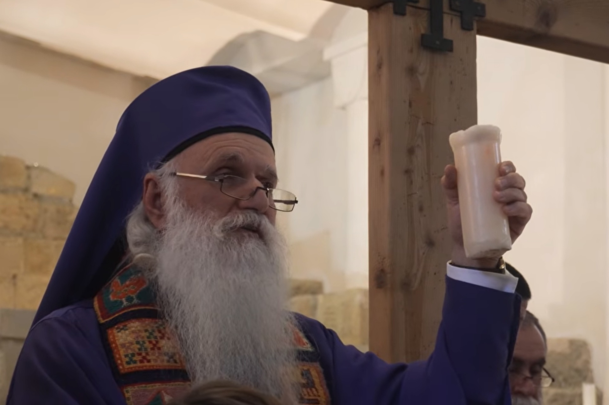

The radically inclusive, welcoming and liberalising Christianity which inspired a Bath IFG group when we visited Tbilisi Georgia recently was this week presented and discussed on a global stage of distinguished theologians. 

The occasion was the [Global Forum of Theological Educators](https://gfte.org/). This distinguished group of theological leaders from every Christian tradition - Orthodox, Roman Catholic, Historical Protestant, Evangelical, Pentecostal, and independent - met in Nairobi Kenya 4-6 Nov for a conference entitled *Doing theological education together*. 

They invited as a keynote sessions speaker Malkaz Songulashvili, Metropolitan Bishop of Tbilisi, who hosted the Bath IFG visit to Tbilisi. He was perhaps a surprising choice, given the GFTE is a considered a generally conservative gathering. As part of his presentation - titled *Building Bridges that Last* - he showed [a nine-minute edit of the film made of the Bath IFG trip by Errol Russo - see it here](https://www.youtube.com/watch?v=45lHy-gaLBk).

His talk was followed by responses from the Australian Pentecostal theologian Dr Clayton Coombs, the American Catholic [Prof Anathea Portier-Young](https://divinity.duke.edu/faculty/anathea-portier-young) and Orthodox priest from Kenya [Fr Dr Evangelos Thiani](https://www.researchgate.net/profile/Fr-Dr-Evangelos-Thiani) and then general discussion.

While we don't yet know the full impact of the session, Bath IFG is delighted to have helped in a small way to bring Bishop Malkhaz' progressive and liberalising message to this important forum. The full text of Bishop Malkhaz’ talk is below. 

*Bishop Malkhaz preaches in the Peace Cathedral. Photo from the film by Errol Russo for Bath IFG.*

## **Nothing and Everything**

## **What Enables Sustainable and Transformative Collaboration? Lessons from the Peace Cathedral in Georgia**

**The Most Rev’d Professor Dr Malkhaz Songulashvili**  
Metropolitan Bishop of Tbilisi  
Professor of Comparative Theology, Ilia State University, Georgia  
**1\. Introduction: Nothing and Everything**  

Some time ago, following a presentation about the Peace Cathedral in Tbilisi at a round-table discussion in Bucharest, the chair, the Rev’d Dr Stefan Cosoroaba, posed a question that has remained with me: “What can we learn from this paper?”  

His initial answer was unexpected: “Nothing\!” After a deliberate pause, he added emphatically: “And everything\!”  

I have come to appreciate the theological significance of this apparent contradiction. We can learn nothing if we imagine that a particular initiative can simply be transplanted from one context into another. Every community has its own history, wounds, religious traditions, political realities and social possibilities. What works in Tbilisi cannot necessarily be reproduced in Nairobi, just as the experiences of theological institutions in Kenya cannot simply be imported into Georgia.  

Yet we can learn everything if we look beyond the external forms of a project to the convictions, relationships and practices that make it possible.  

At the heart of this experience lies one of the most fundamental commandments of Jesus: **“You shall love your neighbour as yourself”** (Mark 12:31). Yet this raises an important question: who is our neighbour? Jesus addresses precisely this question in the parable of the Good Samaritan (Luke 10:25–37). In this remarkable story, he challenges the religious and ethnic boundaries by which people determine whom they should regard as their neighbour. It is the Samaritan, a member of a community viewed with suspicion and hostility by many of Jesus's contemporaries, who becomes the example of genuine neighbourly love. The message is profoundly challenging: our neighbour is not necessarily someone who shares our religious convictions, ethnic identity or cultural background. Neighbourliness is defined not by similarity or belonging, but by compassion, solidarity and our willingness to respond to another person's vulnerability.  

This biblical vision has been fundamental to the development of the Peace Project in Georgia. We have sought to create a space where people of different faiths, cultures and worldviews—and people of no faith—are not merely tolerated but welcomed as neighbours. They may differ from us in many ways, yet they are also remarkably similar in their humanity, vulnerabilities, hopes, fears and longing for dignity. **Our differences do not cancel our common humanity; they invite us to discover it more deeply.** The challenge, therefore, is not simply to learn how to live alongside one another, but how to become better neighbours to one another.  

Today, I want to explore what the experience of the Peace Cathedral in Georgia might contribute to our discussion of sustainable and transformative collaboration in theological education and ministry.  

My central argument is this: **collaboration becomes transformative when we cease to regard other people as objects of our mission and recognise them as neighbours and partners with whom we participate in God's mission. \`It becomes sustainable when this recognition is embodied in relationships of trust, mutuality, shared responsibility and a willingness to redistribute power.**  

This argument has emerged not from an abstract theory of partnership, but from decades of experience: working with refugees, building relationships across religious boundaries, confronting discrimination, and attempting to create a sacred space in which people of different faiths—and people of no faith—can encounter one another without fear.  

The experience has not been easy. It has brought extraordinary friendships, unexpected generosity and moments of profound beauty. It has also brought opposition, misunderstanding, institutional difficulties and financial challenges. It is precisely this combination of achievement and vulnerability that makes it worth sharing.

**2\. Theological foundations: Collaboration as participation in *Missio Dei***

The concept of *Missio Dei*, the mission of God, offers an essential starting point.

Developed particularly in twentieth-century missiological discussions, the concept challenges the assumption that mission belongs primarily to the church as an institution. Rather, the church participates in a mission that originates in God and extends beyond ecclesiastical boundaries. God is already at work in the world,  in- and outside of familiar traditions and institutions, calling creation towards reconciliation, justice, healing and the fullness of life. That's to remind each one there that everyone in that room is a partner in Missio Dei, even if there are sharp disagreements in praxis. The point is, we are called to listen to other voices than our own.

This has profound implications for collaboration.

If the church believes that it possesses God’s mission as its exclusive property, partnership will inevitably be unequal. We will approach others as recipients of our generosity, beneficiaries of our wisdom or potential converts to our convictions. We may speak the language of cooperation while retaining the assumption that we alone determine its purpose and direction.

But if mission belongs to God, we must become more attentive to the possibility that God is at work in people whose beliefs, practices and experiences differ from our own. We may discover that those whom we imagined ourselves called to serve are also capable of teaching us, challenging us and transforming our understanding of faithfulness.

This does not require Christians to abandon their theological convictions. It requires us to distinguish between faithfulness to Christ and the desire to control others.

The Christ whom Christians encounter in the Gospels repeatedly challenges established hierarchies of authority and religious respectability. He receives hospitality from outsiders, commends the faith of unexpected people and identifies himself with those who are hungry, displaced, sick or imprisoned. In Matthew 25, the decisive question is not whether the vulnerable person belongs to the correct religious community, but whether that person has been welcomed, fed, clothed and cared for.

In the words of Henri J. M. Nouwen, "Compassion asks us to go where it hurts, to enter into the places of pain, to share in brokenness, fear, confusion, and anguish. Compassion challenges us to cry out with those in misery, to mourn with those who are lonely, to weep with those in tears. Compassion requires us to be weak with the weak, vulnerable with the vulnerable, and powerless with the powerless. Compassion means full immersion in the condition of being human."  According to Laura Fitzpatrick-Nager "Jesus throughout his ministry of justice and healing demonstrated the way of compassion--compassion as the compass of every parable, every paradox, every personal encounter on the roads of Jesus's travels." 

The implication for theological education and ministry is clear: **we cannot claim to participate faithfully in God's mission while treating our neighbours merely as instruments of our own institutional or religious objectives.**

Collaboration begins with a theological conversion—a willingness to recognise that God may be at work beyond the boundaries within which we have become accustomed to locating the divine.

**3\. From historical wounds to solidarity: The Georgian experience**

The Peace Cathedral has its roots in a Baptist congregation established in Tbilisi in 1867\. Throughout its history, this community has experienced restrictions, marginalisation and opposition under successive political and religious circumstances, including the Tsarist and Soviet periods and the rise of contemporary religious nationalism.

Such a history can produce two very different responses. A community may become defensive, seeking security through isolation and protecting its identity by excluding those perceived as different. Alternatively, it may allow its experience of vulnerability to deepen its solidarity with others who suffer.

The second possibility has shaped our understanding of ministry.

One particularly important turning point came in 1999, when our community became deeply involved in assisting Chechen refugees. These people had fled conflict and displacement and needed practical assistance, safety and human companionship.

Our encounter with them challenged us to reconsider the meaning of mission. We were not simply a Christian institution providing services to a population in need. We were entering relationships with people whose suffering demanded a response and whose lives would also change us.

Over time, this experience contributed to a broader commitment to refugees, religious minorities and other marginalised communities. Our work has included solidarity with Muslims facing discrimination in Georgia, support for vulnerable people during the COVID-19 pandemic, and assistance to communities affected by conflict beyond our borders.

These experiences have taught me that collaboration rarely begins with a comprehensive strategy. Sometimes it begins with a person who needs help, a door that must be opened, a meal that must be shared or an injustice that cannot be ignored.

A relationship develops through action. Trust grows through repeated encounters. A shared sense of responsibility emerges, often before anyone has found the appropriate language to describe it.

This is an important lesson for theological institutions. We sometimes invest considerable energy in developing partnership frameworks, strategic plans and institutional agreements. These can be valuable, but they cannot substitute for the experience of standing beside another person when doing so is difficult or costly.

**Sustainable collaboration requires more than agreement about shared values; it requires experiences through which those values become trustworthy.**

**4\. From dialogue to shared life: The Peace Project**

The Peace Project emerged from the Peace Cathedral's commitment to addressing religious prejudice and creating practical forms of interfaith cooperation.

Its vision gradually took architectural and institutional form. Within one complex, we developed spaces for Christian worship, a mosque, a synagogue, a Buddhist shrine and an Oratory of Reconciliation for people of any faith or none.

The significance of this arrangement lies not simply in the physical proximity of different religious traditions. Its deeper purpose is to create conditions in which difference can be encountered without being treated as a threat.

For many years, interfaith engagement has concentrated on dialogue: representatives of different religions meet, exchange ideas, discover common ground and issue statements about peace. Such encounters are valuable, but dialogue alone may leave existing relationships of power untouched. Participants return to their separate institutions, and the practical conditions of their lives may remain unchanged.

The Peace Project attempts to take a further step. Our communities do not merely meet in one another's buildings; they share an institutional home.

This means sharing the same entrance, roof, architectural framework and public responsibility, while maintaining distinct spaces for worship and preserving the integrity of each tradition.

The model does not erase theological differences. A mosque must remain a place in which Muslims can worship as Muslims; a synagogue must enable Jewish worship; and a church must remain recognisably Christian. Genuine collaboration does not require us to pretend that our traditions are identical.

Instead, we seek a form of unity in which difference is not an obstacle to cooperation but a condition of its richness.

Rabbi Jonathan Romain has described the Peace Project as a significant development in interfaith relations, drawing attention to the importance of communities sharing not merely goodwill but a common physical and social environment.

For our purposes today, the central lesson is that **collaboration becomes transformative when it moves from occasional encounters to shared practices, shared responsibilities and a durable commitment to one another's flourishing.**

This is relevant to theological education as much as to interfaith ministry. What might happen if students of Christianity, Islam, Judaism, Buddhism and other traditions did not encounter one another only in lectures about religious diversity, but also participated in common projects addressing poverty, displacement, environmental degradation and social exclusion?

What might change if theological educators treated colleagues from other traditions not simply as guest speakers, but as intellectual partners whose insights could reshape curricula, research questions and institutional priorities?

The Peace Cathedral cannot answer these questions for every institution. It can, however, invite us to ask them more seriously.

**5\. Trust, mutuality and the redistribution of power**

Let me identify three practices that have proved particularly important in our experience.

**First, trust must become visible in practice.**

Trust is not established by declarations alone. It develops when people discover that their partners are reliable, that commitments are honoured and that disagreements do not automatically threaten the relationship.

At the Peace Cathedral, trust has often taken material form.

When we travelled to Iran to obtain marble for the floors of our worship spaces, a Shia Muslim businessman offered us the material at a remarkably generous price after learning about the purpose for which it would be used.

On another occasion, a Shia Muslim cleric who wished to support the Peace Mosque offered us financial assistance. We declined the proposed donation but welcomed his gift of two beautiful walnut doors, one intended for the mosque and the other for the synagogue.

Similarly, when the Israeli ambassador to Georgia offered financial assistance for the synagogue, we asked whether the contribution could instead support the completion of the mosque. He subsequently contributed €8,000 towards its entrance gate, dome and minarets.

These gestures were not simply acts of generosity. They represented a willingness to invest in the flourishing of a religious community other than one's own.

They also illustrate an important distinction: trust becomes stronger when generosity is not used to establish ownership, dependency or control.

The arrangements we made were particular to our circumstances, and such rules cannot be prescribed universally. Nevertheless, the underlying principle deserves attention. Partnership requires financial and institutional practices that protect mutual dignity and prevent generosity from becoming an instrument of domination.

For theological institutions, this means being transparent about funding, decision-making and accountability. It also means asking difficult questions: Who sets the agenda? Who controls the resources? Whose priorities determine the direction of a project? Can a partner disagree without fearing that financial or institutional support will disappear?

**Second, mutuality requires a willingness to learn.**

Many partnerships appear collaborative while retaining a distinction between those who possess knowledge and those expected to receive it.

The same problem can arise in theological education. Institutions with greater financial resources, international visibility or academic prestige may unintentionally assume that they have more to teach than to learn.

The Peace Project has challenged us to recognise the intellectual and spiritual resources of our partners.

Muslim friends, Jewish colleagues, Buddhist practitioners and others have contributed not only materials or financial assistance but also ideas, artistic expressions, relationships and forms of wisdom that have enriched our understanding of peace.

The Buddhist shrine in our cathedral, for example, was made possible through the contributions of Muslim and Christian friends. Its existence reminds us that cooperation can create possibilities that none of the participants could have produced independently.

Mutuality does not mean that every partner contributes identical resources. One may offer money, another expertise, another practical labour, another access to a community, and another the moral courage to question assumptions that others have taken for granted.

What matters is that contributions are received with respect and that every partner is recognised as possessing agency.

For theological education, mutuality should shape the exchange of scholars, the design of research projects, the development of curricula and the allocation of resources. Partnerships between institutions in Africa, Europe, Asia and other regions must move beyond the assumption that knowledge flows principally from well-resourced institutions to less-resourced ones.

Every context possesses knowledge generated through its own history, struggles, spiritual traditions and encounters with injustice. Sustainable collaboration creates structures in which this knowledge can influence the whole partnership.

**Third, shared leadership calls us to be wise to expressions of power and control, especially within structures of authority**

This is perhaps the most difficult lesson.

It is relatively easy to invite people to a meeting. It is more demanding to allow them to influence decisions. It is harder still to accept that genuine partnership may require us to surrender some control.

At the Peace Cathedral, our commitment to shared sacred space has required us to think carefully about how different communities are represented, how their particular needs are respected and how the overall project serves more than one constituency.

Theological collaboration faces a similar challenge. Institutions may speak about equality while retaining decision-making arrangements that privilege the most powerful partners. Women, minority communities, younger scholars and institutions in less wealthy regions may be welcomed into the conversation without receiving meaningful authority over its direction.

We must therefore move beyond asking whether everyone has been invited. We must ask whether everyone has a voice, whether that voice can influence outcomes, and whether the distribution of resources reflects the partnership's professed commitments.

Shared leadership is not achieved merely by placing representatives around the same table. It requires us to examine who designed the table, who determines its agenda and who has the power to decide when the conversation is over.

**6\. Beauty as a practice of collaboration**

One of the distinctive features of the Peace Project is what I have come to call a *missiological theology of beauty*.

We live in a world in which fear is repeatedly mobilised against those who are different. Fear can become suspicion; suspicion can become dehumanisation; and dehumanisation can make exclusion and violence appear acceptable.

In Georgia, our church has witnessed religious prejudice, hostility towards Muslims and violence against LGBTQ+ people. We have also encountered the temptation to respond to hostility with hostility.

We have chosen another path: to confront ugliness through beauty, not by ignoring injustice, but by creating visible alternatives to it.

Beauty, in this understanding, is not decoration. It is an ethical and theological practice. It is the decision to make room for another person, to honour a tradition one does not personally follow and to create an environment in which dignity becomes tangible.

The architecture of the Peace Cathedral expresses this conviction in many ways.

Our interior stone walls are deliberately unfinished. They remind us that the work of justice and reconciliation is never complete. No generation can claim to have finished the task.

The windows on the cathedral's façade are narrow on the inside and wider on the outside. Inspired by a Jewish interpretive tradition concerning the Temple in Jerusalem, they symbolise a sacred space that does not merely receive light but allows light to radiate outwards.

The Amos Wall, created in response to the war in Ukraine, draws on the prophet's declaration: “Let justice roll down like waters, and righteousness like an ever-flowing stream” (Amos 5:24). Its imagery joins water and sun, justice and peace, in a visual statement that beauty must remain accountable to righteousness.

These features teach us something about sustainable collaboration. Relationships need more than administrative arrangements. They also need shared symbols, meaningful practices and spaces that express what the partners hope to become together.

In theological education, art, music, architecture, ritual and storytelling can help communities imagine forms of relationship that political and institutional language alone cannot adequately express.

Yet beauty must never become a substitute for justice (even though justice itself is an expression of beauty). A beautiful building can conceal unequal relationships just as easily as it can challenge them. Its significance depends on whether the values expressed in its design are embodied in the way people are treated.

The unfinished walls therefore offer a necessary reminder: the beauty of a collaborative project lies not in the perfection of its appearance, but in the continuing work of making its relationships more just.

**7\. Sustainability: What happens when collaboration becomes costly?**

It would be misleading to present the Peace Cathedral as an uncomplicated success story.

Our commitment to religious inclusion and minority rights has brought criticism and opposition from political and religious circles. The congregation has faced institutional difficulties and periods of isolation. Our work has required considerable financial sacrifice, and the maintenance of shared spaces presents continuing challenges.

Such experiences raise an important question for this conference: what enables collaboration to survive when it becomes costly?

First, partners need a shared purpose strong enough to sustain them through disappointment. Relationships built solely around convenience or institutional advantage may collapse when difficulties arise. A commitment to human dignity, justice and reconciliation can provide a deeper foundation.

Second, collaboration requires institutional memory. Personal friendships are indispensable, but they are vulnerable to changes in leadership, illness, retirement and the passage of time. Sustainable partnerships must therefore develop practices, agreements, documentation and structures that enable new generations to inherit the work.

Third, partnerships need honest mechanisms for addressing disagreement. Trust does not mean the absence of conflict. It means that differences can be acknowledged without automatically turning partners into enemies.

Fourth, sustainability requires the distribution of responsibility. A project that depends entirely on the energy, resources or personality of one leader may achieve remarkable things but remain fragile. Shared leadership, succession planning, financial transparency and the formation of younger leaders are therefore essential.

Finally, we must recognise that sustainability does not mean preserving every institution or arrangement indefinitely. Sometimes a partnership must change its form, relinquish an unhelpful practice or acknowledge that a particular initiative has reached its natural conclusion. Faithfulness lies in sustaining the mission, not necessarily every structure created in its name.

These lessons are particularly important for theological institutions working across differences in wealth, political influence and institutional capacity.

A sustainable partnership cannot depend on one party perpetually giving and another perpetually receiving. Nor can it require the less powerful partner to remain silent about injustice in order to preserve institutional harmony.

Faithful collaboration must be capable of surviving honest criticism, changing leadership and the redistribution of responsibility.

**8\. Implications for theological education and ministry**

What, then, might theological educators and church leaders take from the Georgian experience?

I would suggest five practical commitments.

**First, begin with relationships rather than institutional branding.** Before asking what a partnership can deliver, ask whom it serves, whose needs have been heard and whether the people concerned have helped define its purpose.

**Second, make collaboration part of theological formation.** Students should not learn about peace, justice and religious diversity exclusively through texts and lectures. They should have opportunities to work alongside people from other traditions and communities, reflecting critically on the experience.

**Third, share authority as well as expertise.** Partners should participate meaningfully in setting research agendas, designing programmes, managing resources and evaluating outcomes. Institutions with greater resources must be willing to learn and, where necessary, relinquish control.

**Fourth, connect theological reflection with practical solidarity.** Common projects addressing displacement, poverty, environmental responsibility, discrimination and other forms of human suffering can create relationships that survive beyond conferences and formal declarations.

**Fifth, build for continuity without losing the capacity for change.** Partnerships need transparent governance, adequate resources, conflict-resolution mechanisms and opportunities for younger leaders to take responsibility. They also need the freedom to revise their methods when experience reveals that something is not working.

These commitments cannot be reduced to a universal formula. Each institution must discern how they can be embodied within its own context. But they provide a framework for evaluating whether our collaboration is merely functional or genuinely transformative.

## **9\. Conclusion: A shared home for God's mission**

Let me return to the words that gave this paper its title: **“Nothing—and everything.”**

The Peace Cathedral is a particular project, rooted in Georgia's history and shaped by relationships across religious and cultural differences. Its architecture cannot simply be replicated, nor can its institutional arrangements serve as a universal model.

In that sense, perhaps there is nothing to copy.

And yet there may be everything to learn.

We may learn that trust is built through faithful action; that mutuality means learning to receive as well as give; that shared leadership requires relinquishing control; and that sustainable collaboration depends on relationships capable of surviving disagreement and adversity.

Above all, we may discover that those we encounter are not merely recipients of our mission, but partners through whom we encounter new dimensions of God's work in the world.

For God's mission precedes us and exceeds us. The Holy Spirit is not confined to our institutions, traditions or programmes. We are invited not to own this mission, but to participate in it.

This is why the Peace Cathedral aspires to be more than a collection of religious spaces. It seeks to be a shared home where differences are honoured, relationships cultivated and peace becomes a common responsibility.

Such a home is never finished. Its doors must remain open, its hospitality renewed and its foundations strengthened by the willingness of different communities to build a common future without having to become the same.

Perhaps this is the central lesson I bring to our conversation in Nairobi:

**The measure of collaboration is not how successfully we bring others into our projects, but how faithfully we learn to build a common future with them.**

I leave you with three questions:

1. What must change in our theological institutions for those traditionally regarded as recipients of mission to become genuine partners in shaping it?  
2. How can we translate trust, mutuality and shared leadership into our budgets, governance and everyday practices?  
3. What might become possible if we understood theological education and ministry as participation in God's wider work of reconciliation rather than the preservation of our separate achievements?

I offer the Peace Cathedral not as a universal model, but as an invitation: to make hospitality a practice, difference a resource and collaboration a way of life.

Perhaps, in the end, this is how we learn both nothing and everything.

**Thank you.**

