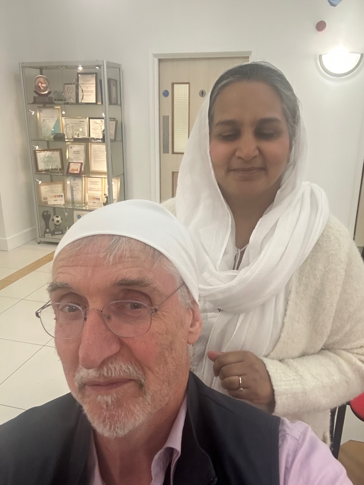

*Bath Mayor Ruth Malloy invited Bath IFG members to reflect on her theme for the year "let's celebrate community, culture and curiosity". Here Bath IFG chair William Heath offers a Quaker perspective.*
--
As the Religious Society of Friends, more commonly known as Quakers, we’re advised to live adventurously, to let our lives speak and to walk cheerfully across the earth seeking that of God in everyone. 

This isn’t Scripture. It’s not the cast-iron word of God handed down from some ancient text in a long-dead language. It’s a distillation of many decades of discernment of Quakers, coming from a simple practice of worship rooted in Christianity. 

Quakers worship mostly in silence, patiently waiting for the promptings of the spirit. 

Some of the resulting insights are set out in the booklet *Advices and Queries*. 

A community isn’t made by seeking and hanging out with people most like ourselves. It’s the result of living together peacefully and respectfully listening to and learning from people who are different. 

From the same text: “Do you welcome the diversity of culture, language and expressions of faith…? Seek to increase your understanding and to gain from this rich heritage and wide range of spiritual insights.”

It’s not simply about finding ways to put up with people, tho a degree of tolerance is at least preferable to succumbing to the rising tide of hatred and division. Those who want to divide us obsess about skin colour. But there’s so much more to celebrate than different forms of human beauty: language, music, food, art, customs and the deepest insights about life and what it means to be human that different cultures can bring. 

Quakers are advised always to be open to new light; to seek new insights from wherever they might come. 

We don’t have to agree with people to be interested in how they approach life. We can pretty much always learn from these encounters. Hence our present focus in the Bath Inter Faith Group on getting better at difficult conversations. We can always learn from encounters with others about what works and what doesn’t. Just sometimes we might come across profound insights, life-changing deep wisdom in other traditions which we would not have found without curiosity and the richness of diversity we have in our community. 

On our pilgrimage to Tbilisi Georgia I shared a sentence by the Quaker William Penn in his text Some Fruits of Solitude: "The humble, meek, merciful, just, pious and devout souls everywhere are of one religion and when death has taken off the mask, they will know one another, though the diverse liveries they wore here make them strangers"

That’s the context in which Quakers approach inter faith work. 

So as we celebrate the diversity we have in Bath let’s start out with curiosity to explore these cultures and build the community we want to be.

*Photo: preparing to visit the Nishkam Centre Sikh Gudwara in Birmingham for the launch of Inter Faith Week.*
