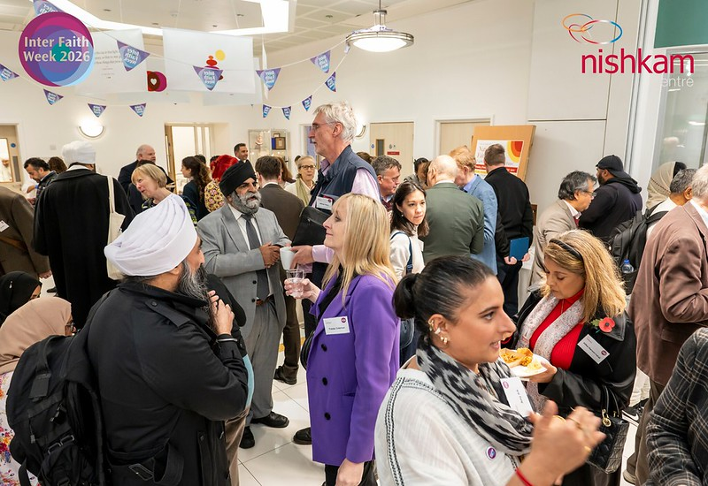
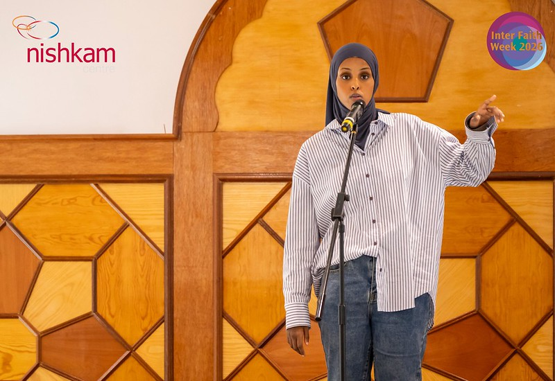
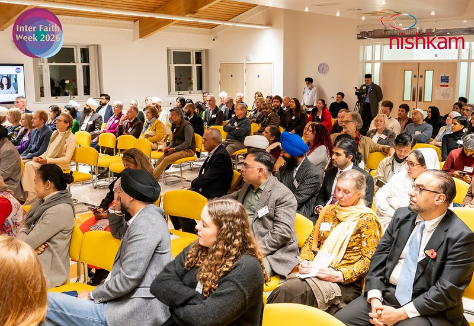
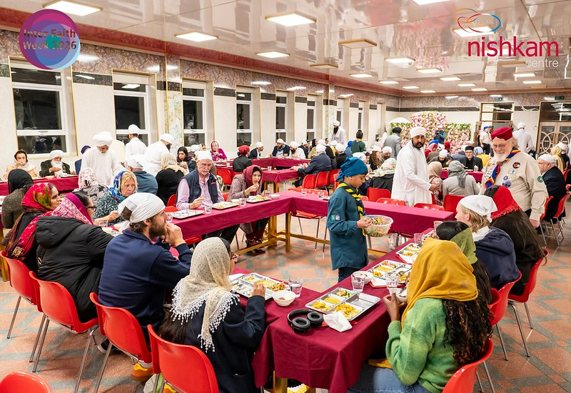
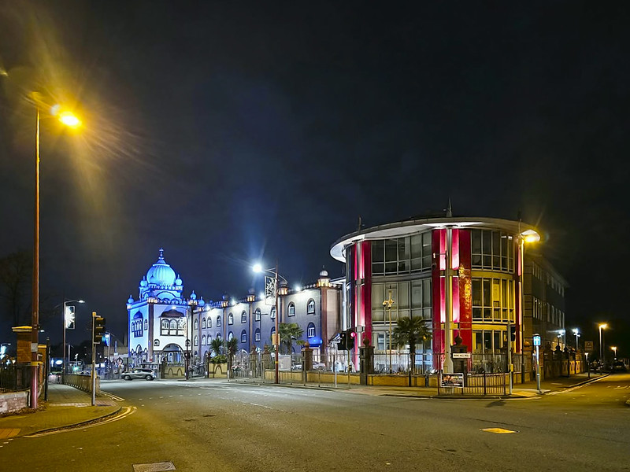

[Inter Faith Week 2026](https://www.interfaithweek.org/) launched on 3 Nov with an exhibition, music, talks and generous welcoming hospitality at the [Nishkam Centre in Handsworth, Birmingham](https://ncauk.org/). The theme for this year’s Inter Faith Week is *Lighting the Way for a Shared Future*.

Birmingham is a great choice to showcase multi faith and multi cultural work. We were treated to first-rate sacred Sikh hymns (*Shabad Kirtan* performed by volunteers from Guru Nanak Nishkam Sewak Jatha) and poetry by Birmingham’s recent poet laureate [the Somali Ayan Aden](https://www.ayanmoaden.com/). Both absolutely worth checking out and hearing more of. 

Much of the programme focussed on the intersection of faith and civic service. [Prof Andrew Davies](https://www.birmingham.ac.uk/staff/profiles/tr/davies-andrew) gave a fascinating and inspiring historic account of Birmingham's *Civic Gospel* movement, when non-conformist faith leaders such as George Dawson, RW Dale and HW Cross revitalised the fast-growing city during the c19th with clean water, parks, libraries and schools. They held that “the public duty of the state is the private duty of the citizen”.

The Nishkam Centre itself is a remarkable contemporary example of faith manifesting as selfless civic service. The Gurdwara (temple) serves 25,000 free meals a week to visitors. The complex also holds an impressive multi-faith school based on religious virtues; we heard from the headmistress and also from an astonishingly articulate and composed Yr 10 Muslim boy. On the theme of education one speaker - my notes aren’t clear - made the excellent point that more important than learning about the faiths is learning from the faiths. That small change could make RE a lot less dull. 

*The main building and conference room where we met is presented not a community centre just for Sikhs but a civic centre based on Sikh virtues.*

The afternoon was rounded off with a generous meal served by the highly competent and efficient kitchen team. It’s hard to calculate how much good this faith-based project achieves in Handsworth, this sometimes recently troubled but inspiring and historic district of Birmingham. But the crowning glory of the day for me - after the music, poetry, faith, culture learning and food - was the chai. The ladies of the Nishkam Centre have taken the making of masala chai to a sublime level. Another gift to the world. 

*Thank you to the organisers, speakers, and all those giving selfless service at the Nishkam Centre.*

