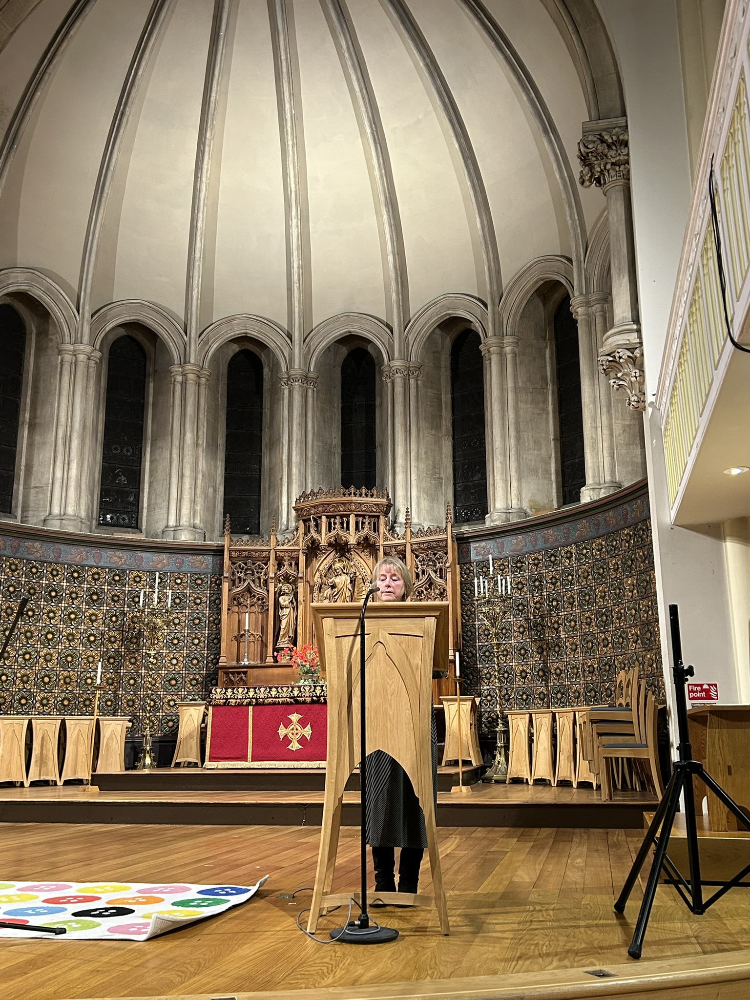

*This talk was given by Bath IFG member Jane O'Hara at the Inter Faith Week Finding Peace Together event, a collaboration between Spirit of Peace, Christ Church and the Bath IFG. It too place on 17 Nov, in the presence of the Lord-Lieutenant of Somerset and the Mayor of Bath.*

I have been asked to share with you how my faith has shaped my perspective on Peace.

This happened when I came across a religion new to me – the Bahá’i Faith.

My early life was spent as a Catholic in the 1950s, 1960s: I had a narrow view of life (not generally aware of politics / no TV til I was in my teens, but aware of major events: Moon landing, assassination of JFK and his brother a few years later, and the on-going war in Vietnam). I remember a growing sense of insecurity with regard to the on-going Cold War and developing USA / Russia hostilities etc.  

As I left home to go to University, I met different people of different religions, and was intrigued to discover many of the teachings and stories of these had similar features to Christianity. But in general (as many people) I was busy getting on with my life and went away from involvement in formal religion – finding it not relevant to my life – but I always retained a belief in God.

My first career was as a research scientist, and I never felt any conflict with this belief in God – after all, science is all about finding out about the natural / physical world and God relates to the spiritual world – and I suppose like many I tended to see them as separate things.

Then, in my mid-30s (in the 1980s) I came across the Bahá’i Faith - while I was working as a research scientist for a few years at the University of the South Pacific: on a small island, Western Samoa. There, in the middle of this unspoilt, paradise island of palm trees and beaches, was a very futuristic-looking Bahá’i House of Worship serving a small regional community. I had the opportunity to learn about the teachings of the Bahá’i Faith – a religion completely unknown to me, which seemed to resonate with all the best and most wise teachings about how humanity should behave. And with the great aim to bring about world peace through recognition that all humanity is equal in the sight of God.

So the central message is an exhortation to overcome our prejudices as a necessity for, to work for, unity in diversity. Baha'u'llah, the founder of the Bahá’i faith speaking in the nineteenth century, says:

*Say O friends! The tabernacle of unity hath been raised; regard ye not one another as strangers. Ye are the fruits of one tree, and the leaves of one branch* Provisional Translations, Lawh-i Manikji Sahib)

And again:
*So powerful is the light of unity that it can illuminate the whole earth.* (Baha'u'llah, Epistle to the Son of the Wolf, p. 14)

Notice that He is speaking about the whole earth at a time when mankind had not yet reached the moon…

The teachings say that *world peace is not only possible but inevitable. It is the next stage in the evolution of this planet* (the Universal House of Justice, 1985 Oct, The Promise of World Peace, p. 3)

But that *world order can be founded only on an unshakeable consciousness of the oneness of mankind, a spiritual truth which all the human sciences confirm.* (The Universal House of Justice, 1985 Oct, The Promise of World Peace, p. 4)

And so *Recognition of this truth requires abandonment of prejudice -- prejudice of every kind -- race, class, colour, creed, nation, sex, degree of material civilization, everything which enables people to consider themselves superior to others.* (The Universal House of Justice, 1985 Oct, The Promise of World Peace, p. 4)

And furthermore: *The well-being of mankind, its peace and security, are unattainable unless and until its unity is firmly established.* (Baha'u'llah, The Kitab-i-Aqdas, p. 11)

The Bahá’i Faith explains that all religions have the same spiritual message (though they differ in their social teachings) and this is because they all originate from the same spiritual source (the same One God) but were revealed at different points in humankind’s development.

I had not heard of a religion where working to bring about peace had such an emphasis. And, because there are no clergy in the Bahá’i Faith – we can all contribute: the teachings of the Bahá’i Faith show us how.
For example (especially relevant in the period between the Great Wars -but also still very relevant):
*It insists upon the subordination of national impulses and interests to the imperative claims of a unified world. It repudiates excessive centralization on one hand, and disclaims all attempts at uniformity on the other. Its watchword is unity in diversity …* (Compilations, The Compilation of Compilations vol II, p. 178)

Other precepts include:
The equality of men and women,
Universal education, 
Non-violence,
The importance of consultation, rather than a few imposing their views on others,
And reciprocity rather than competition or coercion.

These are explicit teachings and therefore immediately relevant to how we live our lives – the ideals are high, but through trying to live up to them we can hope to find peace together, at least on a local scale.

[Note: the quotations in italics I have used are all direct quotes from the teachings of the Bahá’i Faith. [Official website: https://www.bahai.org/](https://www.bahai.org/)

