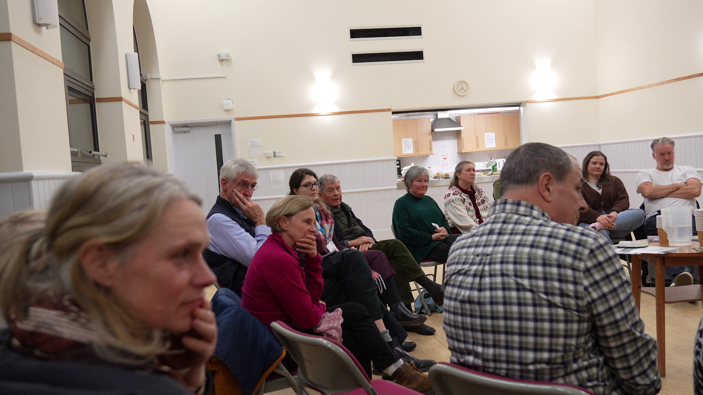
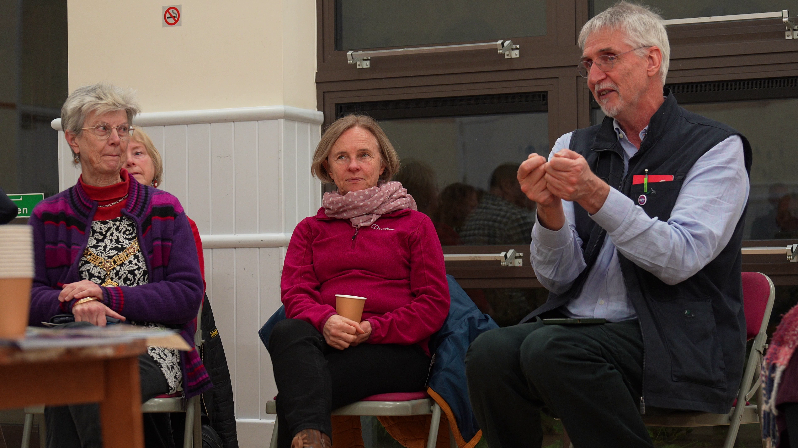
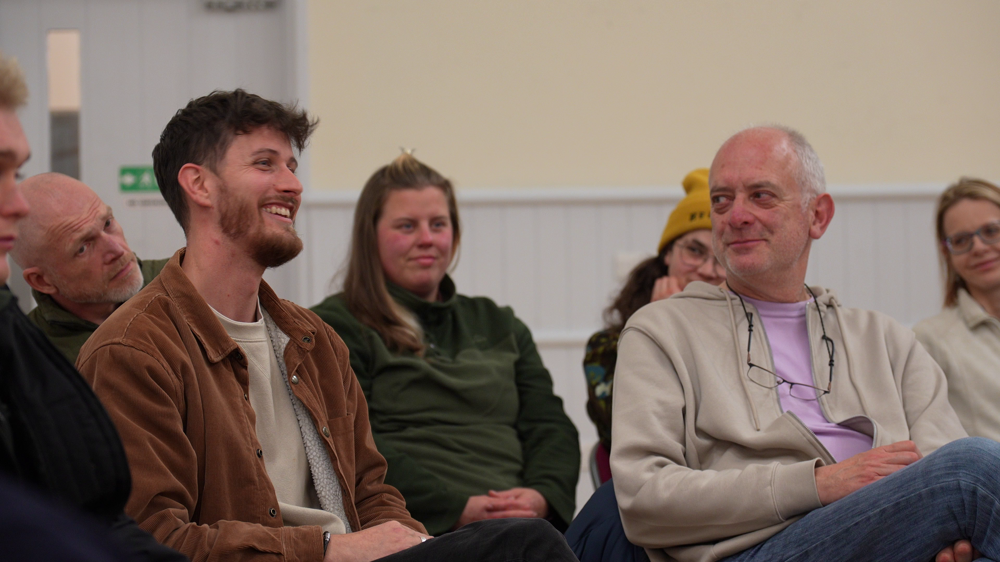

Bath IFG convened a fostering workshop at [Our Lady and St Alphege Church on 25 November](https://saintalphege.org.uk/). Just over two dozen people including Methodist, Pentecostal, Bahai, Humanist, Roman Catholic and other traditions met over soup and cheese rolls. We heard in turn from fostering experts, carers, people who had grown up in care or with fostered siblings. 

Like most local councils, Bath & NE Somerset (B&NES) Council faces a critical shortage of foster carers. If Bath was truly a community that valued young people it would offer adequate care for the most vulnerable. As it is, many vulnerable young children end up in private-equity owned for-profit residential care homes. These are far from Bath, wherever property is cheapest. And the owners, motivated not by love but by money, charge our Council upward of £300,000 per year for one child. 

The Bath IFG project to find more carers for B&NES is called “Leap of Faith”. This is how one B&NES carer described her decision to become a foster carer. We also heard that fostering can be the most challenging and also the most rewarding thing people ever do. We heard from the charity Home for Good, which has worked over many years to reach out and support Christian foster carers. Their approach has proven highly effective, with a success rate of around 50% from initial enquiries. We are told the national average is just 3-5%, with B&NES doing rather better than that at around 10%. 

We learned that fostering is love in action. We heard of vulnerable children who feel they are not worthy of love, and the transformative effect that providing a secure, loving environment makes to young people’s lives. This, we felt, is something that resonates across all faith traditions. 

There is a vibrant support group in Bath called Mockingbird. Without exception carers spoke highly of the support offered by B&NES Council. There’s a rigorous four to six month onboarding process to ensure potential foster carers are suitable. But there are also misconceptions: we learned that age, most forms of criminal record, not having enough bedrooms are not automatic disqualifiers. Motivation, understanding what’s involved and the family set up and situation are what matters. There is a package of financial support, council tax and income tax relief. 

Faith groups represent a promising way to reach potential carers. If you’re interested in fostering and hearing more about the Leap of Faith project please email chair@BathIFG.org.uk.

Photos by Errol Russo: participants at the Leap of Faith event at St Alphege Church
