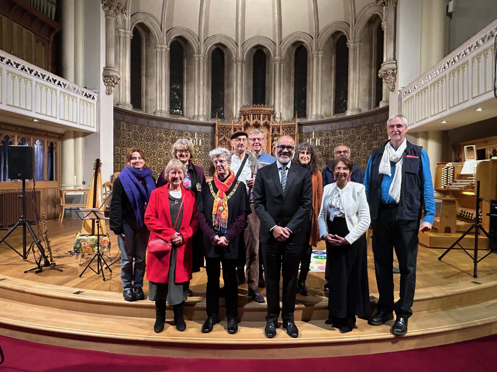
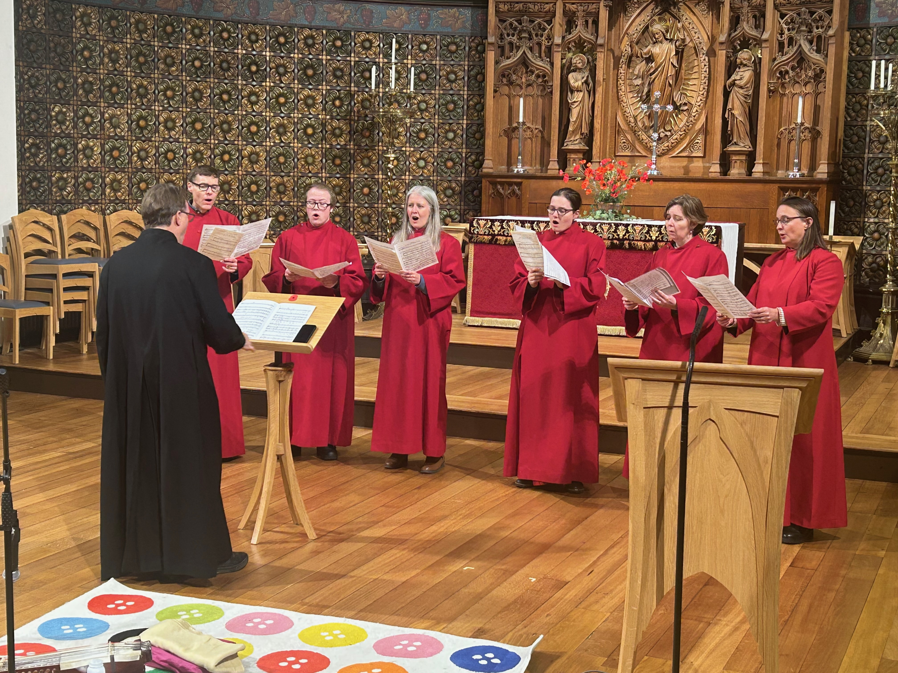
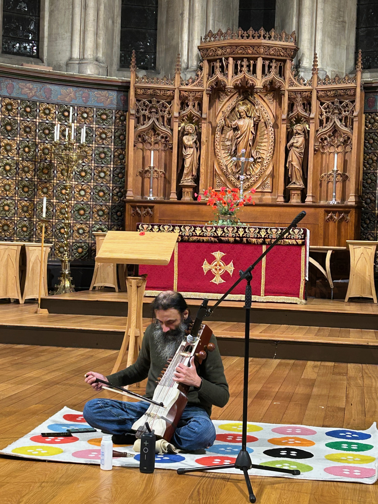
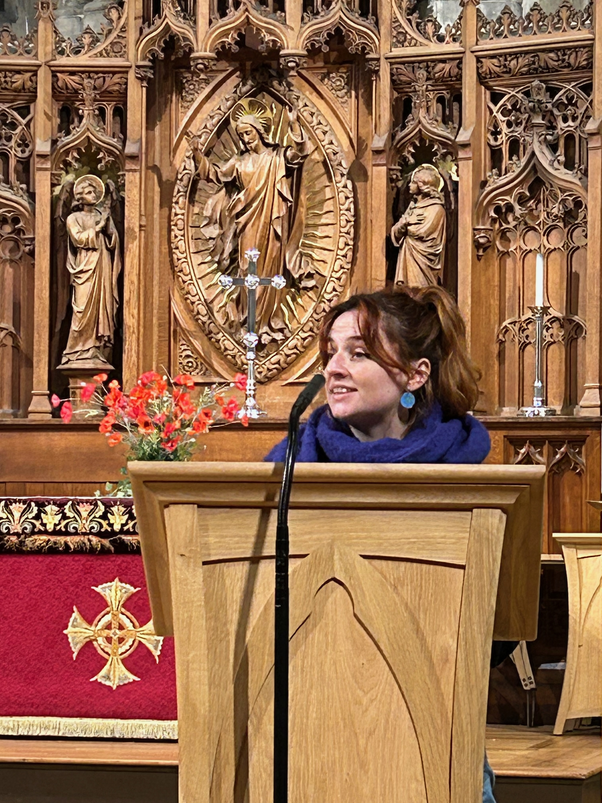

Inter Faith Week saw Bath's second event done with the charity Spirit of Peace: an evening of music, talks and food. We were welcomed to Christ Church in Julian Road by Revd Heather Smith, with further welcomes from Lord Lieutenant of Somerset Mohammed Siddiq, who quoted King Charles' words on strength in diversity, and from the Mayor of Bath Ruth Malloy who spoke about community cohesion.

The Christ Church choir performed works by John Rutter and Peter Aston. We heard accordion, sax and violin playing, also classical Indian music prayer and drumming. Particularly moving was testimony by Rachel about the practice of Christianity in China and her journey to life in the UK.

Ellie Bowes from Museum of Bath at Work gave a fascinating historical perspective on Bath's peace celebration at the end of WWI. Inspired by her account of the party we decided the Bath IFG also needed a project which required two tons of cake.

We finished with shared food and convivial conversation. It was a warm and wonderful evening, much enjoyed and appreciated by all. Many thanks to the organisers and all involved.
